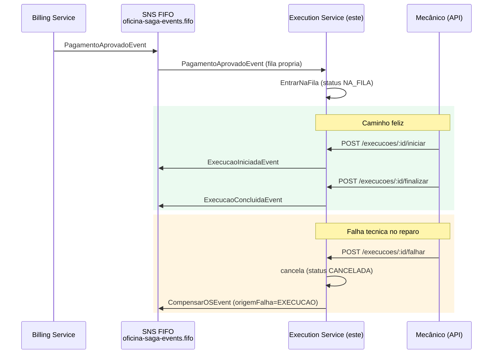

# oficina-execution-service

Terceiro e último microsserviço da Fase 4. Responsável pela fila de
produção, atribuição de mecânico e execução do reparo na oficina. Dono
exclusivo de um banco **PostgreSQL** próprio (`execution_service`) —
nenhum outro microsserviço acessa essa base diretamente.

| Repositório | Papel |
|---|---|
| [oficina-messaging-infra](https://github.com/marcosrenansilvafaria-afk/oficina-messaging-infra) | Broker SNS/SQS FIFO + contratos de evento do Saga |
| [oficina-os-service](https://github.com/marcosrenansilvafaria-afk/oficina-os-service) | Microsserviço de Ordem de Serviço |
| [oficina-billing-service](https://github.com/marcosrenansilvafaria-afk/oficina-billing-service) | Microsserviço de orçamento/pagamento |
| **oficina-execution-service** (este) | Microsserviço de fila de produção/execução |

## Sumário

- [Propósito](#propósito)
- [Fluxo (diagrama de sequência)](#fluxo-diagrama-de-sequência)
- [Saga Pattern — consome e publica](#saga-pattern--consome-e-publica)
- [Banco de dados](#banco-de-dados)
- [Execução local](#execução-local)
- [Swagger / OpenAPI](#swagger--openapi)
- [Testes e cobertura](#testes-e-cobertura)
- [Deploy no EKS](#deploy-no-eks)
- [Variáveis de ambiente](#variáveis-de-ambiente)
- [Pendências conhecidas](#pendências-conhecidas)

## Propósito

Gerenciar o ciclo de vida da execução do reparo: entrada na fila de
produção (quando o pagamento é aprovado), início pelo mecânico, conclusão
e, em caso de falha técnica, compensação do Saga (cancela a execução e
aciona o estorno no Billing Service).

## Fluxo (diagrama de sequência)



## Saga Pattern — consome e publica

Ver [SAGA_PATTERN_SPEC.md](https://github.com/marcosrenansilvafaria-afk/oficina-app/blob/main/docs/SAGA_PATTERN_SPEC.md)
para o desenho completo.

**Consome** (fila `oficina-saga-execution-service.fifo`):

| Evento | Ação |
|---|---|
| `PagamentoAprovadoEvent` | `EntrarNaFila`: cria a `Execucao` (`NA_FILA`) para a OS |
| `CompensarOSEvent` | `CompensarExecucao`: cancela a `Execucao` da OS se ela existir e ainda não estiver `CONCLUIDA`/`CANCELADA` — idempotente para os dois `origemFalha` |

**Publica** (tópico `oficina-saga-events.fifo`):
- `ExecucaoIniciadaEvent` — mecânico inicia o reparo (`NA_FILA → EM_EXECUCAO`).
- `ExecucaoConcluidaEvent` — mecânico finaliza o reparo (`EM_EXECUCAO → CONCLUIDA`).
- `CompensarOSEvent` (`origemFalha=EXECUCAO`) — falha técnica durante o reparo (`EM_EXECUCAO → CANCELADA`).

## Banco de dados

Database PostgreSQL próprio (`execution_service`) na **mesma instância
RDS** do Repositório 1 (mesmo padrão do OS Service — database dedicado,
sem instância nova). Tabelas: `execucoes` (máquina de estados) e
`historico_intervencoes` (append-only, uma linha por transição — mesmo
padrão de `OrdemServicoStatusHistorico` no OS Service).

**Pendência**: bootstrap (`CREATE DATABASE` + usuário dedicado) só
executável de dentro da VPC — ver [`scripts/bootstrap-database.sql`](scripts/bootstrap-database.sql),
aguardando o EKS ser recriado (mesma pendência do OS Service).

## Execução local

```bash
docker-compose up --build
```

Sobe um Postgres local (porta `5434`) + a API em `http://localhost:3003`.
Migrations rodam automaticamente no boot.

## Swagger / OpenAPI

`http://localhost:3003/docs`.

## Testes e cobertura

```bash
npm test                  # unitarios (Jest)
npm run test:cov:critical # cobertura de domain/entities + application/use-cases, gate >= 80%
npm run test:bdd          # BDD (jest-cucumber) - fluxo feliz + falha/compensacao
npm run test:e2e          # end-to-end (supertest)
```

BDD (`test/bdd/execucao.feature`, 2 cenários): fluxo feliz completo
(pagamento aprovado → fila → início → fim, com `ExecucaoIniciadaEvent` e
`ExecucaoConcluidaEvent` publicados) e falha técnica durante o reparo
(`CompensarOSEvent` com `origemFalha=EXECUCAO` publicado).

## Simulação E2E do Saga (Sprint 5)

Os testes acima validam este serviço isoladamente. A validação do Saga
coreografado **entre os 3 microsserviços reais** (publicando/consumindo
no SNS/SQS FIFO real, não um emulador) vive em
[`oficina-app/test/saga-e2e/`](https://github.com/marcosrenansilvafaria-afk/oficina-app/tree/main/test/saga-e2e)
— veja o README daquela suíte para pré-requisitos e instruções
(`docker compose -f docker-compose.saga-e2e.yml up` + `npm run test:saga-e2e`,
executado a partir do `oficina-app`).

## Deploy no EKS

Pipeline em [`.github/workflows/ci-cd-execution-service.yml`](.github/workflows/ci-cd-execution-service.yml),
mesma estrutura dos outros 2 microsserviços: `lint-test` → `sonarqube`
(condicional) → `docker-build-push` → `deploy` (condicional, inclui o Job
de migration).

**Pendência**: cluster EKS destruído ao final da Fase 3 — job `deploy`
fica `skipped` até `vars.EKS_DEPLOY_ENABLED=true`.

## Variáveis de ambiente

Ver [`.env.example`](.env.example): `DATABASE_URL`, `SAGA_TOPIC_ARN`/
`SAGA_QUEUE_URL`, `JWT_SECRET` (**idêntico** aos demais serviços).

## Pendências conhecidas

- **Bootstrap do database**: aguardando o EKS existir de novo (ver seção
  "Banco de dados").
- **SonarCloud**: conta ainda não criada — mesma pendência dos outros 2
  serviços.
- **EKS**: cluster destruído — deploy real ainda não exercido.
